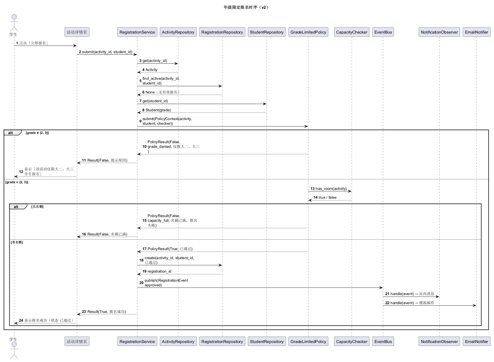
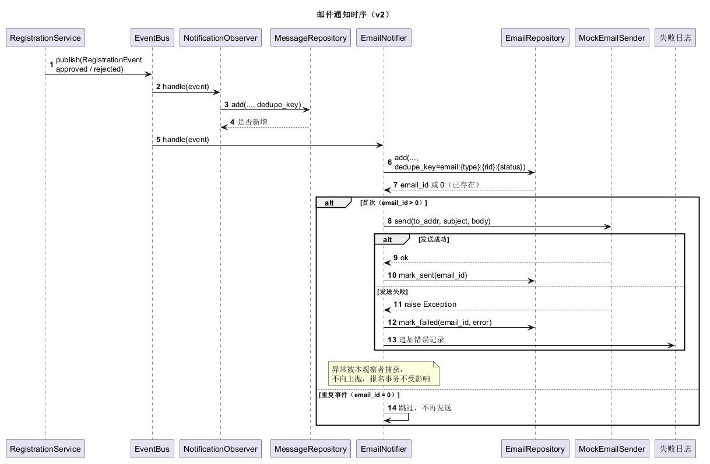

# 时序图（v2 / change-v2）

> 与 v1 相比只增加两条关键交互：年级判定、邮件通知。
> 报名提交、审批、通知发布的事务边界与 v1 一致（事务提交后发事件）。

## 1. 年级限定报名



源文件：`docs/diagrams/seq-grade-v2.puml`

**要点**

1. `RegistrationService.submit` 顺序仍是：取活动 → 判开始时间 → 查有效报名 → 取策略 → 构造 `PolicyContext` → 事务内落库 → 发事件；唯一新增是构造上下文前调用 `StudentRepository.get`。
2. `GradeLimitedPolicy` 先判年级：不满足直接返回 `PolicyResult(False, 'grade_denied', ...)`，**不查容量、不落库**。
3. 年级满足才复用父类逻辑，由 `CapacityChecker.has_room` 决定是否还有名额。
4. 三种失败互不混淆：年级不符 `grade_denied`、名额满 `capacity_full`、已报名 `duplicate`、活动已开始 `started`。
5. 成功路径与 v1 相同：状态「已通过」→ 发 `approved` 事件 → 站内消息 + 邮件两个订阅者各自处理。

## 2. 邮件通知



源文件：`docs/diagrams/seq-email-v2.puml`

**要点**

1. `EmailNotifier` 只订阅 `approved` / `rejected`；待审核、取消不发邮件。
2. 幂等：`dedupe_key = email:{事件类型}:{registration_id}:{状态}`，`emails.dedupe_key` 有 UNIQUE 约束，`INSERT OR IGNORE` 返回是否新增。
3. **先占位、后发送**：占位成功才调用 `MockEmailSender.send`；重复事件拿到 0 行，直接跳过，保证同一业务事件不重复发送。
4. 发送失败：捕获异常 → `mark_failed(email_id, error)` + 写失败日志；异常不向上抛，报名事务已提交，状态不受影响。
5. 站内消息与邮件互不影响：邮件失败不会阻止站内消息，反之亦然。
6. 观察者内的异常仍会被 `EventBus` 兜底记录（`instance/notification_failures.log`），属第二道防线。

## 与 v1 时序的差异

| 场景 | v1 | v2 |
|---|---|---|
| 直接报名 | 策略只看容量 | 策略先看年级，再看容量 |
| 审核报名 | 固定「待审核」 | 不变 |
| 审批通过/拒绝 | 站内消息 | 站内消息 + 模拟邮件 |
| 通知失败 | 记录到 failure log | 记录到 failure log，且邮件单独记录失败状态 |

## 重新出图

```bash
java '-Dfile.encoding=UTF-8' -jar <plantuml.jar> -tpng -charset UTF-8 docs/diagrams/seq-grade-v2.puml
java '-Dfile.encoding=UTF-8' -jar <plantuml.jar> -tpng -charset UTF-8 docs/diagrams/seq-email-v2.puml
```
