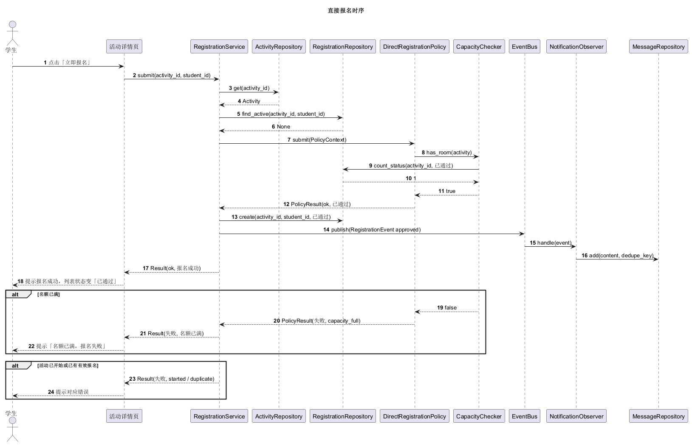
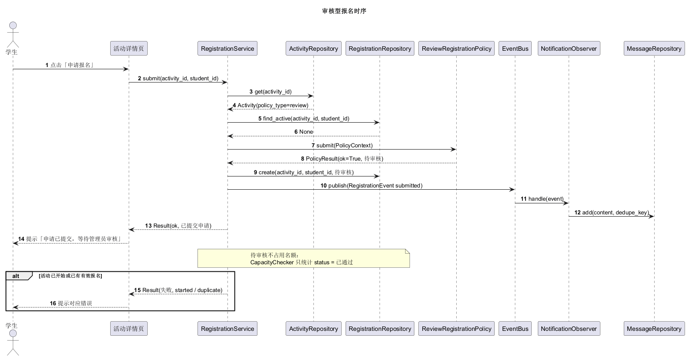
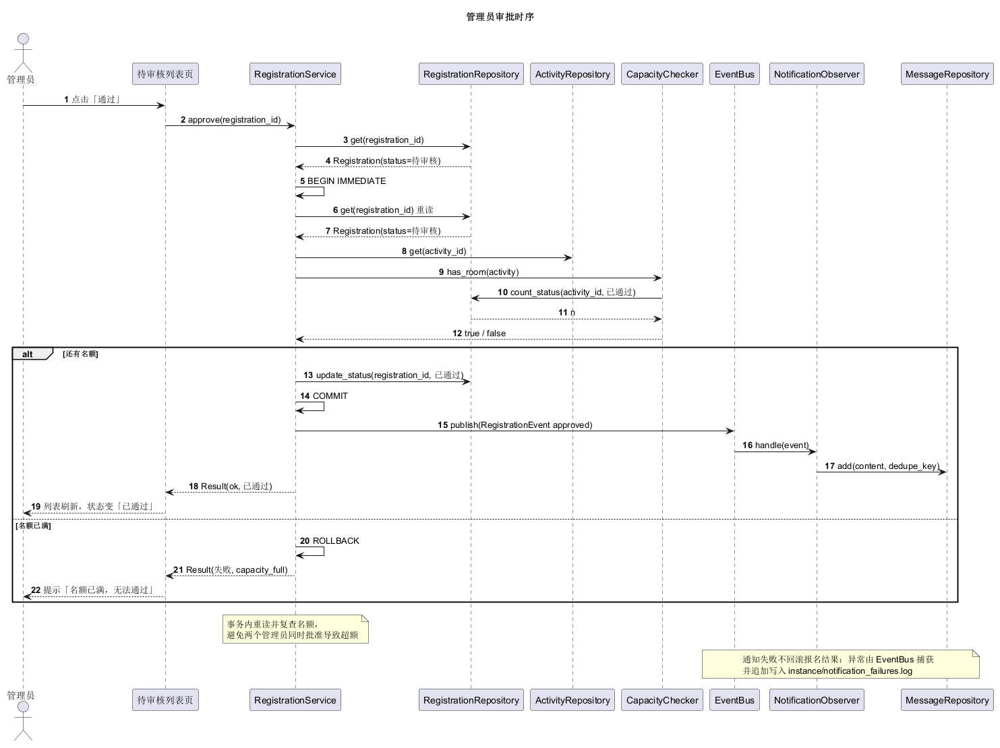

# 关键时序图（baseline-v1）

## 1. 直接报名（自动通过）

要点：
1. 视图收到 `POST /activities/{id}/register`，调用 `RegistrationService.submit`；
2. 服务先查活动（不存在/已开始则拒绝）、再查是否已有有效报名（避免重复）；
3. 调 `DirectRegistrationPolicy.submit`，策略经 `CapacityChecker.has_room` 统计「已通过」人数；
4. 有名额 → 落库为「已通过」；无名额 → `capacity_full`，不写库；
5. 提交后发事件 → `NotificationObserver` 写站内消息（`dedupe_key` 幂等）。

## 2. 审核型报名（进入待审核）

要点：
1. 活动 `policy_type = review`，策略直接返回「待审核」，**不做名额检查**；
2. 落库为「待审核」，待审核不占名额（`CapacityChecker` 只统计「已通过」）；
3. 提交后发 `submitted` 事件 → 消息「申请已提交，等待管理员审核」；
4. 同一学生对同一活动的有效报名唯一（部分唯一索引兜底）。

## 3. 管理员批准（事务内复查名额）

要点：
1. `RegistrationService.approve` 先确认记录仍是「待审核」；
2. 在 `BEGIN IMMEDIATE` 事务内重读记录并调用 `CapacityChecker.has_room`；
3. 还有名额 → 更新为「已通过」并提交；名额已满 → 回滚，报名保持「待审核」；
4. 提交后发 `approved` 事件 → 消息「报名已通过」；
5. 事务内复查是为了避免两个管理员同时批准导致超额（C8）。

## 4. 说明

- 通知在**事务提交之后**发布，失败不回滚报名；`EventBus.publish` 捕获订阅者异常并写 `instance/notification_failures.log`（R6 留痕）。
- `NotificationObserver` 用 `dedupe_key = type:registration_id:status` 幂等写入，避免重复通知。
- 审批的名额复查与状态更新在同一个 `BEGIN IMMEDIATE` 事务内完成，避免并发批准超额（C8）。
