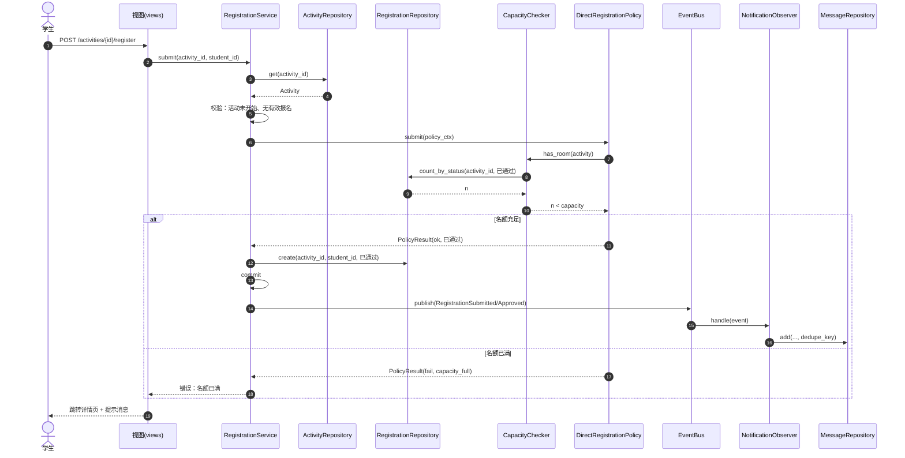
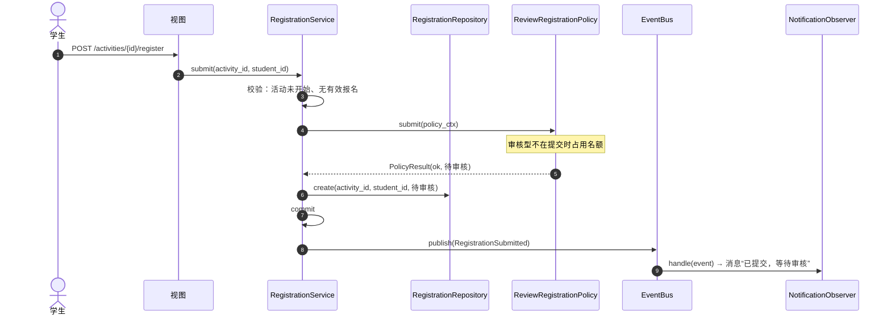
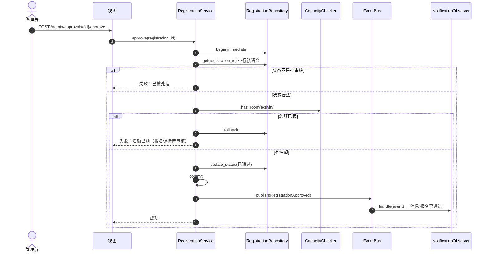

# 关键时序图（baseline-v1）

## 1. 直接报名（自动通过）

## 2. 审核型报名（进入待审核）

## 3. 管理员批准（事务内复查名额）

## 4. 说明

- 通知在**事务提交之后**发布，失败不回滚报名；`EventBus.publish` 捕获订阅者异常并写 `instance/notification_failures.log`（R6 留痕）。
- `NotificationObserver` 用 `dedupe_key = type:registration_id:status` 幂等写入，避免重复通知。
- 审批的名额复查与状态更新在同一个 `BEGIN IMMEDIATE` 事务内完成，避免并发批准超额（C8）。
