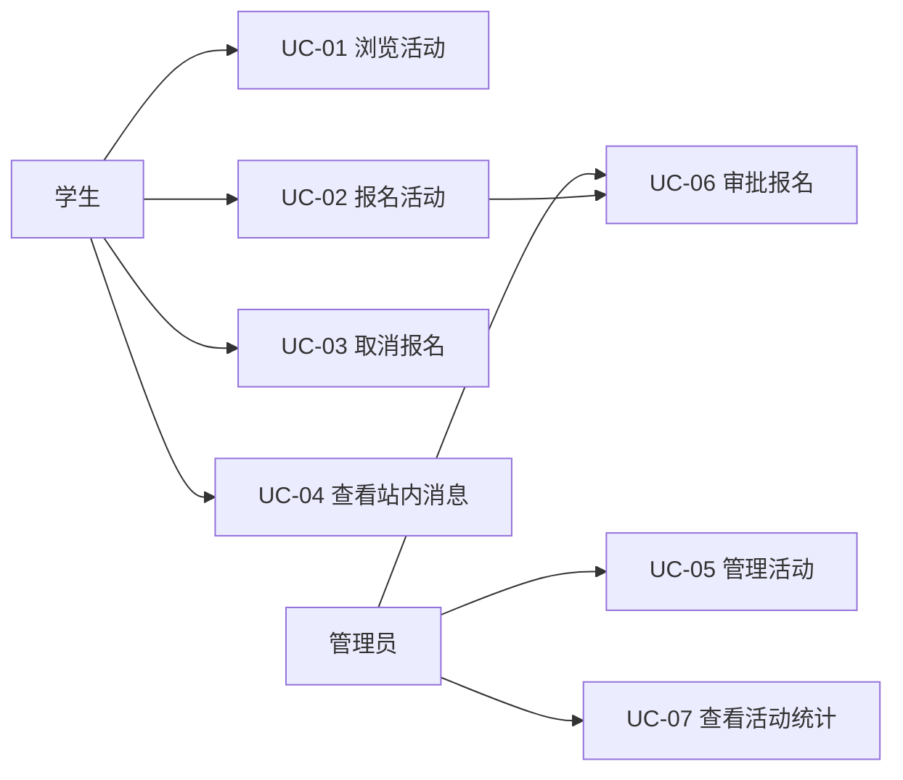

# 用例说明（baseline-v1）

## 0. 用例总览

## UC-01 浏览活动

- **参与者**：学生
- **前置**：无
- **主流程**：进入活动列表 → 按名称筛选（可选）→ 点开详情查看容量、剩余名额、报名方式
- **异常**：活动不存在 → 404
- **后置**：无数据变化

## UC-02 报名活动

- **参与者**：学生
- **前置**：活动存在、未开始
- **主流程**：
  1. 学生在详情页点“报名”；
  2. 系统校验：活动未开始、无有效报名、名额满足策略要求；
  3. 按 `policy_type` 分派策略：
     - 直接报名：创建“已通过”记录，发消息“报名成功”；
     - 审核型：创建“待审核”记录，发消息“已提交，等待审核”。
- **异常**：
  - A1 名额已满（直接报名）→ 提示“名额已满”，不落库；
  - A2 存在待审核/已通过报名 → 提示“请勿重复报名”；
  - A3 活动已开始 → 提示“活动已开始，无法报名”。
- **后置**：报名记录落库；消息落库（通知失败仅留痕，不影响报名）。

## UC-03 取消报名

- **参与者**：学生
- **前置**：本人存在“待审核”或“已通过”报名
- **主流程**：我的报名 → 取消 → 二次确认 → 状态改为“已取消”，更新时间
- **异常**：非本人报名 → 403/404；状态不可取消 → 提示
- **后置**：统计同步；历史记录保留

## UC-04 查看站内消息

- **参与者**：学生
- **主流程**：消息列表按时间倒序，未读高亮；点开详情可标记已读
- **后置**：`is_read = 1`

## UC-05 管理活动

- **参与者**：管理员
- **主流程**：
  - 创建：填写名称/类型/开始时间/地点/容量/报名方式 → 校验 → 保存；
  - 编辑：修改字段，容量不得小于已通过人数；
  - 删除：若已有报名 → 拒绝删除并提示；否则删除。
- **异常**：容量非正整数、时间为空、类型/报名方式非法 → 表单错误提示

## UC-06 审批报名

- **参与者**：管理员
- **前置**：报名为“待审核”
- **主流程**：
  1. 管理员在待审核列表选择“批准”或“拒绝”；
  2. 批准：事务内复查剩余名额 → 有名额则改“已通过”并发消息；无名额则失败并提示；
  3. 拒绝：改“已拒绝”并发消息。
- **异常**：非待审核状态 → 提示“已被处理”；容量已满 → 批准失败，不超上限
- **后置**：状态与消息落库

## UC-07 查看活动统计

- **参与者**：管理员
- **主流程**：活动列表/详情显示已通过数、待审核数、剩余名额；剩余名额不为负
- **后置**：只读

## 用例与验收用例对应

| 用例 | 覆盖 C1–C10 |
|---|---|
| UC-02 报名 | C1、C2、C3、C4、C5 |
| UC-06 审批 | C6、C7、C8 |
| UC-03 取消 | C9 |
| 全局持久化 | C10 |
