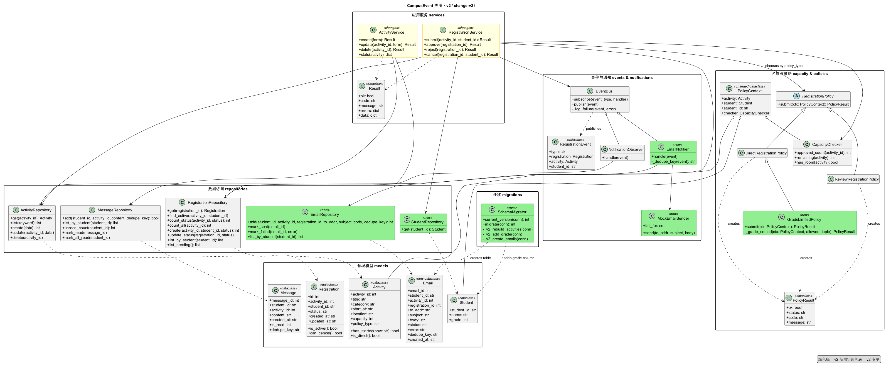

# 类图（v2 / change-v2）

> 基线：`docs/类图.md`（v1，对应 `baseline-v1`）。
> 本图只画结构与依赖，行为细节见 `docs/时序图-v2.md` 与 `docs/变更设计决策报告-v2.md`。

## 渲染图



- 源文件：`docs/diagrams/class-v2.puml`
- 绿色底 = v2 新增；黄色底 = v2 变更
- 重新出图：`java '-Dfile.encoding=UTF-8' -jar <plantuml.jar> -tpng -charset UTF-8 docs/diagrams/class-v2.puml`

## 与 v1 的差异

### 新增（7 个类）

| 类 | 所属包 | 职责 |
|---|---|---|
| `Email`（dataclass） | models | 邮件记录（收件人、主题、内容、状态、错误、幂等键、创建时间） |
| `StudentRepository` | repositories | 按学号读取学生（含年级） |
| `EmailRepository` | repositories | 邮件记录落库、状态更新、按学生查询 |
| `GradeLimitedPolicy` | capacity & policies | 「直接报名 + 年级前置」策略，继承 `DirectRegistrationPolicy` |
| `EmailNotifier` | events & notifications | 邮件观察者：订阅 approved/rejected，做幂等与失败隔离 |
| `MockEmailSender` | events & notifications | 记录式发送器，支持失败注入 |
| `SchemaMigrator` | migrations | 结构版本检测与 v1→v2 迁移（幂等） |

### 变更（4 个类）

| 类 | 变化 |
|---|---|
| `Student` | 新增 `grade: int`（1–4） |
| `PolicyContext` | `student_id` 之外新增 `student: Student`（策略可读年级） |
| `RegistrationService` | `submit` 构造 `PolicyContext` 时传入 `student`（1 行数据注入，逻辑不变） |
| `ActivityService` | 无逻辑变化；仅受 `POLICY_LABELS` 扩充影响（校验放行新取值） |

### 未变

`RegistrationRepository`、`ActivityRepository`、`MessageRepository`、`EventBus`、`NotificationObserver`、`CapacityChecker`、`DirectRegistrationPolicy`、`ReviewRegistrationPolicy`、`Result` 均不改。

## 类图内容说明

| 包 | 关键类 | v2 说明 |
|---|---|---|
| 领域模型 models | Student / Activity / Registration / Message / Email | 只加字段与一个新记录类，不引入行为 |
| 数据访问 repositories | Activity / Registration / Message / Student / Email 五个仓储 | 学生与邮件是新表访问，SQL 集中在此层 |
| 名额与策略 capacity & policies | CapacityChecker、RegistrationPolicy 家族 | 新增一个子类即扩展一种报名规则；容量检查仍由 Checker 统一提供 |
| 事件与通知 events & notifications | EventBus、两个观察者、MockEmailSender | 邮件作为第二个订阅者接入，业务服务只负责发事件 |
| 迁移 migrations | SchemaMigrator | 启动时执行，幂等，负责 CHECK 扩展与建表 |
| 应用服务 services | RegistrationService / ActivityService | 仅装配接线，不承载年级与邮件逻辑 |

## 依赖方向（不变）

```
views → services → repositories / policies / events
                 ↘ capacity
events → observers → repositories / sender
migrations → 数据库结构
```

新增依赖只有两条：`RegistrationService → StudentRepository`（取学生给策略）、`EmailNotifier → EmailRepository / MockEmailSender`（记录与发送）。均为「服务/观察者向基础设施」，没有反向依赖。
