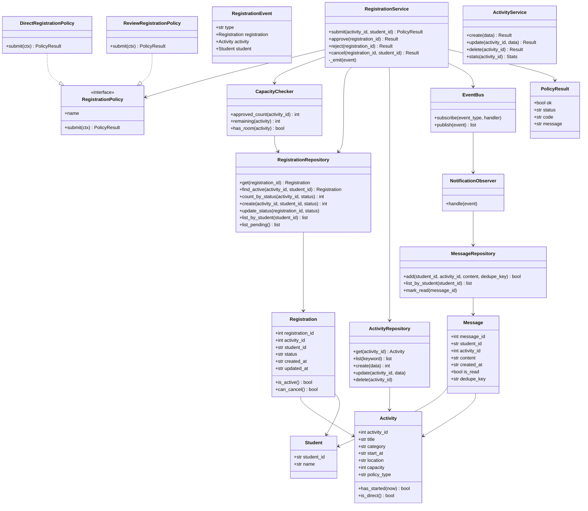

# 类图（baseline-v1）

## 1. 分层与目录

```
CampusEvent/
├── app.py                  # create_app()，注册蓝图、初始化数据库
├── schema.sql              # SQLite 建表 + 约束 + 索引
├── campus/
│   ├── db.py               # 连接管理、初始化
│   ├── models.py           # 领域数据类：Student / Activity / Registration / Message
│   ├── repositories.py     # 数据访问：Activity / Registration / Message
│   ├── capacity.py         # CapacityChecker：名额公共规则
│   ├── policies.py         # 报名策略接口与两种实现
│   ├── events.py           # 领域事件 + EventBus
│   ├── notifications.py    # NotificationObserver：站内消息
│   ├── services.py         # RegistrationService / ActivityService
│   └── views.py            # 学生端、管理员端路由
├── templates/              # Jinja2 模板
├── static/style.css
├── tests/                  # pytest
└── docs/                   # 本目录
```

## 2. UML 类图



## 3. 职责边界说明

| 类 | 单一职责 |
|---|---|
| `ActivityRepository` / `RegistrationRepository` / `MessageRepository` | 只做 SQL 读写，不含业务判断 |
| `CapacityChecker` | 统一计算“已通过数/剩余名额”，作为公共规则被多处复用 |
| `RegistrationPolicy` | 只决定“提交后是什么状态、是否需要即时名额检查”，不直接写库 |
| `RegistrationService` | 编排事务：校验 → 调策略 → 落库 → 发事件；审批时事务内复查名额 |
| `EventBus` | 同步发布事件，隔离订阅者异常 |
| `NotificationObserver` | 把事件翻译成站内消息，按 `dedupe_key` 幂等写入 |
| `views` | 只做参数解析、调用服务、渲染模板 |

依赖方向：`views → services → repositories/policies/events`，领域层不依赖 Flask。
