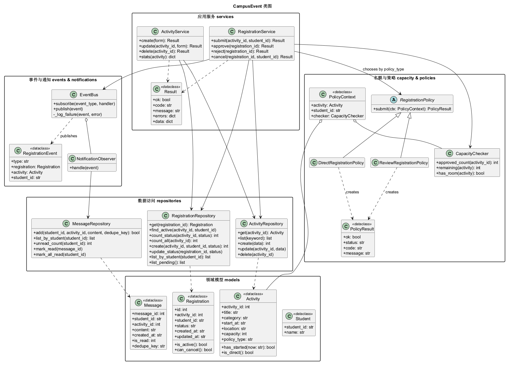

# 类图（baseline-v1）

## 0. 渲染图



> 图源：`docs/diagrams/class.puml`（PlantUML，唯一来源）。
> 重新出图：`java -jar plantuml.jar -tpng -charset UTF-8 docs/diagrams`，或 VS Code 装 PlantUML 插件后 `Alt+D` 预览 / 导出。

## 1. 分层与目录

```
CampusEvent/
├── app.py                  # create_app()，注册蓝图、初始化数据库
├── schema.sql              # SQLite 建表 + 约束 + 索引
├── campus/
│   ├── db.py               # 连接管理、初始化
│   ├── models.py           # 领域数据类：Student / Activity / Registration / Message
│   ├── repositories.py     # 数据访问：Activity / Registration / Message
│   ├── capacity.py         # CapacityChecker：名额公共规则
│   ├── policies.py         # 报名策略接口与两种实现
│   ├── events.py           # 领域事件 + EventBus
│   ├── notifications.py    # NotificationObserver：站内消息
│   ├── services.py         # RegistrationService / ActivityService
│   └── views.py            # 学生端、管理员端路由
├── templates/              # Jinja2 模板
├── static/style.css
├── tests/                  # pytest
└── docs/                   # 本目录
```

## 2. 类图内容说明

图按 5 个包组织，对应代码目录：

| 包 | 关键类 | 说明 |
|---|---|---|
| 领域模型 `models` | `Student`、`Activity`、`Registration`、`Message` | 只含字段与少量状态判断方法（`has_started`、`is_active`、`can_cancel`），不依赖 Flask 和 SQLite |
| 数据访问 `repositories` | `ActivityRepository`、`RegistrationRepository`、`MessageRepository` | 封装全部 SQL；`messages.dedupe_key` 唯一，`MessageRepository.add` 返回是否真的插入 |
| 名额与策略 `capacity & policies` | `CapacityChecker`、`RegistrationPolicy`、`DirectRegistrationPolicy`、`ReviewRegistrationPolicy`、`PolicyContext`、`PolicyResult` | 策略只决定「提交后是什么状态」；名额检查由 `CapacityChecker` 统一提供，避免两条策略各写一遍 |
| 事件与通知 `events & notifications` | `EventBus`、`RegistrationEvent`、`NotificationObserver` | 服务提交后发布事件，观察者写站内消息；订阅者异常只记日志，不影响报名结果 |
| 应用服务 `services` | `RegistrationService`、`ActivityService`、`Result` | 事务边界所在：校验 → 调策略 → 落库 → 发事件；审批时 `BEGIN IMMEDIATE` 内复查名额 |

关键关系：`RegistrationService` 依赖 `RegistrationPolicy`（按活动的 `policy_type` 从注册表选实现）、`CapacityChecker`、两个 Repository 和 `EventBus`；各 Repository 只依赖对应的领域类；`views` 只依赖两个 Service。

## 3. 职责边界说明

| 类 | 单一职责 |
|---|---|
| `ActivityRepository` / `RegistrationRepository` / `MessageRepository` | 只做 SQL 读写，不含业务判断 |
| `CapacityChecker` | 统一计算「已通过数/剩余名额」，作为公共规则被多处复用 |
| `RegistrationPolicy` | 只决定「提交后是什么状态、是否需要即时名额检查」，不直接写库 |
| `RegistrationService` | 编排事务：校验 → 调策略 → 落库 → 发事件；审批时事务内复查名额 |
| `EventBus` | 同步发布事件，隔离订阅者异常 |
| `NotificationObserver` | 把事件翻译成站内消息，按 `dedupe_key` 幂等写入 |
| `views` | 只做参数解析、调用服务、渲染模板 |

依赖方向：`views → services → repositories/policies/events`，领域层不依赖 Flask。
